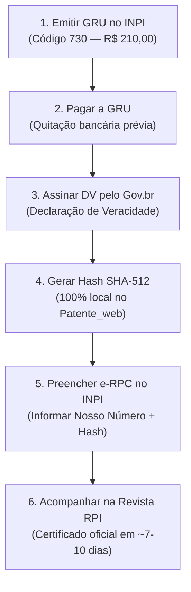

# Guia Oficial: Registro de Software (e-RPC) e Criptografia Hash no INPI

Este documento detalha o funcionamento, as diretrizes legais e a arquitetura técnica do módulo de **Registro de Programa de Computador (e-RPC)** do **Patente_web**, em conformidade com a Lei nº 9.609/1998, as resoluções do **Instituto Nacional da Propriedade Industrial (INPI)** e os padrões do **W3C** para a **Web Crypto API**.

---

## 📌 Sumário
1. [Visão Geral e Diferença: Software Puro vs. Patente CII](#1-visão-geral-e-diferença-software-puro-vs-patente-cii)
2. [Passo a Passo do Processo de Registro no Brasil](#2-passo-a-passo-do-processo-de-registro-no-brasil)
3. [Vantagens e Alcance Legal da Proteção](#3-vantagens-e-alcance-legal-da-proteção)
4. [Como Funciona a Criptografia Hash (SHA-512)](#4-como-funciona-a-criptografia-hash-sha-512)
5. [Segurança e Privacidade: A Web Crypto API (Client-Side Only)](#5-segurança-e-privacidade-a-web-crypto-api-client-side-only)
6. [Cadeia de Custódia Pericial (Regra de Ouro)](#6-cadeia-de-custódia-pericial-regra-de-ouro)
7. [Requisitos de Segurança e Não Funcionais (RNF)](#7-requisitos-de-segurança-e-não-funcionais-rnf)

---

## 1. Visão Geral e Diferença: Software Puro vs. Patente CII

No ordenamento jurídico brasileiro, existem duas formas distintas de proteger tecnologias digitais:

```
                                  Natureza da Solução Digital
                                              │
                    ┌─────────────────────────┴─────────────────────────┐
                    ▼                                                   ▼
       Software Puro, App ou Jogo                        Software Vinculado a Hardware Novo
        (Linhas de código, frontend,                      (Sensores, atuadores, efeito técnico
         backend, bibliotecas, lógica)                     físico mensurável no hardware)
                    │                                                   │
                    ▼                                                   ▼
      Registro de Programa de Computador                   Patente de Invenção (PI / CII)
         (e-RPC — Lei nº 9.609/1998)                       (Resolução INPI nº 158/2016)
                    │                                                   │
       • Proteção autoral (50 anos)                        • Monopólio de invenção (20 anos)
       • Concessão rápida (~7 a 10 dias)                   • Exame técnico formal de novidade
       • Não exige minutas técnicas                        • Exige Relatório, Reivindicações,
       • Exige apenas Hash SHA-512                           Desenhos e Resumo (.docx/.pdf)
```

O **Patente_web** realiza essa triagem logo na primeira etapa, direcionando o usuário para o fluxo adequado.

---

## 2. Passo a Passo do Processo de Registro no Brasil

O fluxo de registro de software foi otimizado para um assistente enxuto de **3 etapas**, eliminando formulários redundantes e focando no que realmente importa:



### Detalhamento das Etapas:

1. **Acessar o Portal do INPI e Emitir a GRU:**
   - Faça login no sistema GRU do INPI.
   - Selecione a unidade **Programa de Computador** e o serviço **Código 730 — Pedido de Registro de Programa de Computador**.
   - O valor atual da taxa federal é de **R$ 210,00** (com desconto legal previsto para pessoas físicas, MEI, ME, EPP e ICTs/Universidades).
2. **Pagar a GRU e Guardar o Número:**
   - **Atenção:** O pagamento deve ser compensado **antes** de protocolar o pedido no site do e-RPC. Protocolar antes da compensação bancária acarreta nulidade do processo.
   - Guarde o **Nosso Número da GRU** (código numérico exigido para abrir o formulário eletrônico).
3. **Assinar Digitalmente a Declaração de Veracidade (DV) no Gov.br:**
   - O próprio sistema do governo gera automaticamente a Declaração de Veracidade ao emitir a GRU. Não é necessário redigir minutas manuais.
   - O titular deve assinar o arquivo PDF original usando sua conta **Gov.br** (nível Prata ou Ouro) pelo [Assinador Oficial do ITI](https://assinador.iti.br) ou via certificado digital ICP-Brasil.
4. **Gerar o Resumo Digital Hash (SHA-512) no Patente_web:**
   - Empacote o código-fonte relevante e documentos do projeto em um arquivo `.zip` ou `.pdf`.
   - Selecione o arquivo na **Etapa 2** do Patente_web. O Hash de 128 caracteres hexadecimais será calculado em memória RAM na sua própria máquina.
5. **Preencher o Formulário no e-RPC do INPI:**
   - Acesse o portal e-RPC, insira o número da GRU paga, cole o Hash SHA-512 gerado e anexe a Declaração de Veracidade assinada digitalmente.
6. **Acompanhar a Publicação na Revista RPI:**
   - Acompanhe a **Revista da Propriedade Industrial (RPI)**, publicada semanalmente às terças-feiras.
   - A concessão do registro costuma ocorrer entre **7 e 10 dias**. Assim que publicado o despacho, baixe o **Certificado Oficial de Registro de Programa de Computador** no portal BuscaWeb do INPI.

---

## 3. Vantagens e Alcance Legal da Proteção

* **Direito Patrimonial (50 anos):** Exclusividade legal para comercializar, alugar, licenciar, ceder ou explorar economicamente o código-fonte a partir de 1º de janeiro do ano subsequente à sua publicação/criação (Art. 2º da Lei nº 9.609/98).
* **Direito Moral:** Reconhecimento inalienável dos desenvolvedores (pessoas físicas) como autores da obra.
* **Segurança Jurídica com Fé Pública:** Prova cabal de anterioridade indispensável em litígios contra pirataria, editais de inovação, captação de investimento e licitações públicas.
* **Proteção Estrutural (Além do Texto Literal):** A proteção abrange não apenas as linhas literais de código, mas também a **arquitetura interna**, a estrutura de chamadas, a integração específica de módulos, bibliotecas e frameworks.
* **Tradução para Outra Linguagem:** A conversão ou tradução não autorizada do seu código para outra linguagem de programação (ex: de Python para C# ou Dart) configura derivação ilícita (plágio), sujeitando o infrator a indenização e medidas judiciais.
* **Não-Exclusividade da Ideia Abstrata:** O registro não protege a ideia abstrata ou modelo de negócios em si, mas a sua expressão formal em código. Outra pessoa pode criar um produto com propósito semelhante, desde que desenvolva seu próprio código de forma totalmente independente.
* **Proteção Complementar de Telas (UI):** Para proteger o design visual das interfaces, ícones e telas do aplicativo, o titular pode depositar complementarmente um pedido de **Desenho Industrial (DI)** no INPI.

---

## 4. Como Funciona a Criptografia Hash (SHA-512)

Uma função de **Hash Criptográfico** é um algoritmo matemático unidirecional que transforma qualquer volume de dados (seja um texto de 10 linhas ou um arquivo zip de 500 MB) em uma sequência de tamanho fixo de caracteres.

```
┌─────────────────────────────────┐
│  Arquivo do Código-Fonte (.zip) │
│  (tamanho variável, ex: 15 MB)  │
└────────────────┬────────────────┘
                 │
                 ▼  Algoritmo Criptográfico Seguro
           ┌───────────┐
           │  SHA-512  │
           └─────┬─────┘
                 │
                 ▼
┌─────────────────────────────────────────────────────────────────┐
│ Resumo Digital Hash de 512 bits (128 caracteres hexadecimais):  │
│ 9f86d081884c7d659a2feaa0c55ad015a3bf4f1b2b0b822cd15d6c15b0f0... │
└─────────────────────────────────────────────────────────────────┘
```

### Propriedades Matemáticas Fundamentais:

1. **Determinístico:** O mesmo arquivo sempre gerará exatamente o mesmo Hash, em qualquer computador do mundo.
2. **Unidirecional (Não Reversível):** É computacionalmente impossível reconstituir o código-fonte a partir do Hash gerado.
3. **Efeito Avalanche:** Se um único ponto, espaço ou letra for alterado dentro do arquivo compactado, **mais de 50% dos caracteres do Hash mudam completamente**, denunciando qualquer adulteração.
4. **Resistência a Colisão:** É estatisticamente impossível encontrar dois arquivos diferentes que gerem a mesma sequência de 512 bits.

O INPI exige a geração de um Hash de **128 caracteres hexadecimais** (algoritmo SHA-512) justamente para registrar a impressão digital do código sem que o órgão precise armazenar segredos industriais em seus servidores.

---

## 5. Segurança e Privacidade: A Web Crypto API (Client-Side Only)

Uma das maiores preocupações de desenvolvedores e empresas é: *“Meu código-fonte será enviado para servidores de terceiros?”*

No **Patente_web**, a resposta técnica é: **NÃO. O código nunca sai do seu navegador.**

### Arquitetura de Execução Local:

* **Padrão W3C Nativo:** O cálculo é realizado pela interface nativa `window.crypto.subtle.digest("SHA-512", buffer)`, embutida diretamente no motor de execução dos navegadores modernos (V8 do Chrome, SpiderMonkey do Firefox, WebKit do Safari).
* **Leitura Direta em Memória RAM:** O arquivo selecionado pelo usuário é lido em formato binário (`ArrayBuffer`) apenas na memória RAM do computador local via JavaScript [`FileReader`](file:///home/joao/Área%20de%20trabalho/Projetos%20/Patente_web/frontend/src/services/hashGenerator.ts#L18-L23).
* **Zero Tráfego de Rede:** Não existe nenhuma requisição de upload (`fetch`, `POST`, `axios` ou `WebSocket`).
* **Auditoria Offline:** Você pode desconectar o computador da internet (desligar o Wi-Fi) e o gerador continuará calculando o Hash perfeitamente.

---

## 6. Cadeia de Custódia Pericial (Regra de Ouro)

> [!CAUTION]
> ### Regra de Ouro da Cadeia de Custódia
> O INPI não guarda cópia do seu código-fonte — ele arquiva apenas o **Hash de 128 caracteres** e a **Declaração de Veracidade**.
> 
> Em caso de litígio judicial (acusação de plágio ou invasão de direitos), o juiz ou perito judicial solicitará o arquivo original do código-fonte e calculará o Hash SHA-512. Se o Hash calculado for idêntico ao que consta no Certificado do INPI, a anterioridade está pericialmente comprovada.
> 
> **Recomendações Obrigatórias:**
> 1. Salve **exatamente o mesmo arquivo `.zip` ou `.pdf`** em pelo menos dois locais seguros e imutáveis (ex: repositório Git com tag assinada, cofre em nuvem institucional e armazenamento físico desconectado).
> 2. **Nunca** renomeie arquivos internos, não recompacte o zip e não altere linhas de comentário após gerar o Hash. A menor alteração muda o Hash e anula a prova pericial.

---

## 7. Requisitos de Segurança e Não Funcionais (RNF)

O módulo de software do **Patente_web** foi projetado seguindo 4 requisitos de segurança estritos:

| Identificador | Requisito | Como o Sistema Garante |
| :--- | :--- | :--- |
| **[RNF01]** | **Sigilo e Não Retenção de Código (Client-Side Only)** | Processamento 100% no navegador via Web Crypto API. O backend não recebe arquivos de código e não há persistência em banco de dados (`Zero-Storage`). |
| **[RNF02]** | **Integridade Probatória (Cadeia de Custódia)** | Alertas visuais mandatórios na tela de Hash e no checklist instruindo o arquivamento imutável do arquivo original. |
| **[RNF03]** | **Sanitização e Validação Estrita de Inputs** | Regex estrito `/^[0-9a-f]{128}$/` no Hash e bloqueio em tempo real de caracteres inválidos; máscara numérica estrita para o número da GRU (`/\D/g`). |
| **[RNF04]** | **Autenticação e Gestão de Documentos Digitais** | Instrução e bloqueio de adulteração da Declaração de Veracidade (DV), preservando a assinatura digital prévia do INPI e orientando a assinatura via Gov.br / ICP-Brasil. |

---

## 🔗 Referências Oficiais
* [Lei nº 9.609, de 19 de fevereiro de 1998 (Lei do Software)](http://www.planalto.gov.br/ccivil_03/leis/l9609.htm)
* [Manual de Registro de Programa de Computador do INPI](https://www.gov.br/inpi/pt-br/servicos/programas-de-computador)
* [Resolução INPI nº 158/2016 (Diretrizes de Exame de Patentes CII)](https://www.gov.br/inpi/pt-br)
* [W3C Web Cryptography API Specification](https://www.w3.org/TR/WebCryptoAPI/)
* [Assinador Digital Gov.br (ITI)](https://assinador.iti.br)
